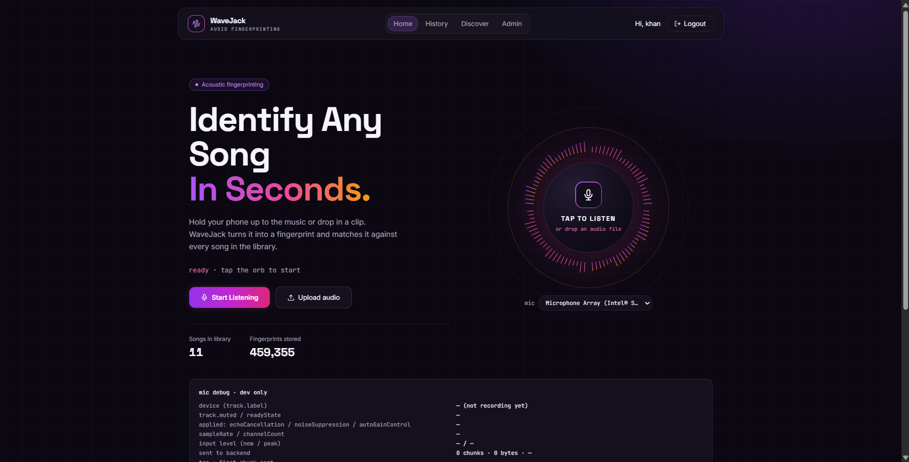
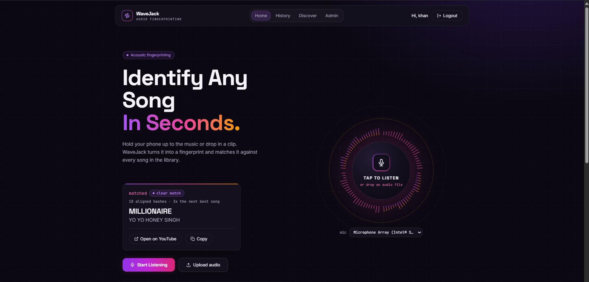
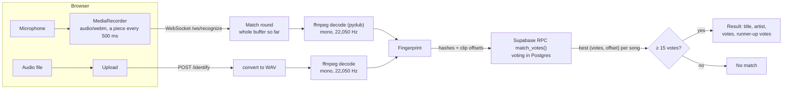

# WaveJack

WaveJack identifies songs from a short audio clip, the way Shazam does. You record from the browser
microphone or upload a file. The backend turns the audio into acoustic fingerprints (spectrogram peaks
paired into hashes), looks them up in a Postgres database, and votes on which song and time offset the
hashes agree on. It is built from scratch with FastAPI, librosa and Supabase on the backend and React
(TanStack Start) on the frontend.




## How it works



- **Fingerprinting** (`backend/fingerprint.py`): STFT spectrogram in dB (librosa defaults: `n_fft` 2048,
  hop 512, at 22,050 Hz mono), local peaks found with a `maximum_filter` over a diamond-shaped
  neighbourhood of radius 10 and a floor of 30 dB below the loudest point, then each peak paired with
  the next 5 peaks in time order that lie at most 200 frames later. Each
  pair becomes `SHA-1(freq1|freq2|delta)` truncated to 16 hex characters, stored with the anchor's frame.
- **Matching** (`supabase/match_votes.sql`): for every clip hash and every stored row with that hash,
  `delta = time_in_song - time_in_clip`. Votes are counted per `(song, delta)` and each song's best
  offset is returned. `/identify` bins deltas in pairs of frames; the WebSocket uses exact deltas. One
  database call per round, and only one row per song comes back.
- **Decision** (`backend/recognizer.py`): a match needs at least 15 aligned votes (`MIN_MATCH_VOTES`).
- **Mic path**: the browser sends a WebM piece every 500 ms. The server runs one match round at a time
  per connection on everything received so far, and answers early once the top song has at least 15
  votes and at least 3× the runner-up (`EARLY_STOP_MARGIN`). Otherwise it keeps listening: 10 s, then
  up to 10 s more if nothing has matched, then a final round decides.
- **Upload path**: `POST /identify` converts the file with ffmpeg, fingerprints all of it, and applies
  the 15-vote rule once.

## Tech stack

| Part | Used |
|---|---|
| Backend | Python 3.13, FastAPI 0.135, Uvicorn, librosa 0.11, NumPy, SciPy, pydub + ffmpeg |
| Database and auth | Supabase (Postgres, Auth with email and password), supabase-py 2.28 |
| Frontend | React 19, TanStack Start / Router, Vite 7, Tailwind CSS 4, Framer Motion, supabase-js |

## Project structure

```
backend/        FastAPI app
  main.py         routes: /identify, /ws/recognize, /songs, /add, /stats, /admin/*
  fingerprint.py  spectrogram peaks -> hashes
  recognizer.py   WebSocket decoding, match rounds, 15-vote and early-stop rules
  database.py     Supabase client, match_votes() call, song storage
  auth.py         Supabase JWT check, admin-only routes
  config.py       env vars and upload limits
  uploads.py      temporary files for uploads
frontend/       TanStack Start app (pages in src/routes: home, history, discover, admin)
supabase/       schema.sql, match_votes.sql, verify_schema.sql
scripts/        recognition_harness.py, ws_stream_harness.py (accuracy and streaming tests), ingest.py
docs/           accuracy.md (latest accuracy report), images/
```

## Setup

### Prerequisites

- **Python 3.13** (verified with 3.13.4). 3.13 is required: `audioop-lts` in `requirements.txt` needs it.
- **Node.js** `^20.19.0` or `>=22.12.0` (what Vite 7 requires; verified with Node 25.1.0, npm 11.19.1).
- **ffmpeg** on `PATH` (verified with ffmpeg 8.1). pydub and the upload path call it.
- A **Supabase** project.

### 1. Database

In the Supabase SQL Editor, run `supabase/schema.sql`, then `supabase/match_votes.sql`.
`supabase/verify_schema.sql` checks what `schema.sql` created. `match_votes` can only be called with the service-role
key. If it is missing, the backend falls back to plain REST lookups with the same voting, but slower.

### 2. Environment variables

Backend: copy `backend/.env.example` to `backend/.env` (or the repo-root `.env`):

| Variable | What it is |
|---|---|
| `SUPABASE_URL` | Project URL (Dashboard → Settings → API) |
| `SUPABASE_KEY` | The **service-role** key. The browser roles have no access to the fingerprints table, so the backend needs it. Keep it out of the frontend. |
| `ADMIN_EMAILS` | Comma-separated emails allowed to use the admin routes (`/add`, `DELETE /songs`, `/admin/*`). The account must exist in Supabase Auth with a confirmed email. Empty = nobody. |
| `FRONTEND_ORIGINS` | Comma-separated browser origins allowed to call the API and open the WebSocket, no trailing slash. |

Frontend: copy `frontend/.env.example` to `frontend/.env.local`:

| Variable | What it is |
|---|---|
| `VITE_API_URL` | Backend URL, no trailing slash. The `ws://` URL is derived from it. |
| `VITE_SUPABASE_URL` | Project URL |
| `VITE_SUPABASE_ANON_KEY` | The public anon (publishable) key, not the service-role key |

### 3. Run

```bash
cd backend
python -m venv venv
venv\Scripts\activate            # macOS/Linux: source venv/bin/activate
pip install -r requirements.txt
uvicorn main:app --reload --port 8000
```

```bash
cd frontend
npm install
npm run dev                      # http://localhost:8080
```

The first recognition after the backend starts is slower: librosa loads and compiles on first use. The
backend runs one warm-up fingerprint at startup to cover most of that.

### 4. Add songs

Sign up in the app with an email listed in `ADMIN_EMAILS` and confirm it. The Admin page then appears
in the navigation. Add each song there with a title, artist, optional YouTube link and the audio file.
Fingerprinting runs during the upload.

## Results

From [`docs/accuracy.md`](docs/accuracy.md), measured when the library had 14 songs (13 with source
files; song 1 was not tested):

> Run on 2026-10-09 18:04 against the live library (14 songs). Total run time 5.0 min, 252 recognitions.

- **Clips:** 3 per song, 10 s each, from the start (from 5 s), the middle, and the end (finishing 10 s
  before the end), each encoded as Opus in WebM at 128 kb/s, like the browser's MediaRecorder.
- **Conditions:** clean; white noise at 20 dB SNR; volume lowered 12 dB, then white noise at 10 dB SNR.
- **Noise**, quoted from the report:

  > Gaussian white noise (`numpy.random.default_rng(seed).standard_normal`, flat spectrum across the whole band), scaled so that RMS(signal) / RMS(noise) = 10^(SNR/20), where the signal RMS is measured over the whole 10 s clip. The result is clipped to [−1, 1]. The seed is fixed per clip and condition, so a rerun produces identical audio.

| Song | clean | 20 dB SNR | 10 dB SNR, -12 dB | Median time to match (/identify · WS) |
|---|---|---|---|---|
| **Total (13 songs)** | **38/39 · 38/39** | **38/39 · 38/39** | **38/39 · 38/39** | **0.9 s · 1.0 s** |

> - /identify overall: 114/117 (97%)
> - WebSocket overall: 114/117 (97%)

> Not-in-library check: `Amit_Kumar;Sonu_Nigam;Alka_Yagnik;Udit_Narayan;Kavita_Krishnamurthy.mp3` ("Bole Chudiyan"), 18 recognitions, expected answer: no match. Correctly rejected: 18/18.

There were no wrong-song matches. All six misses are the same clip: the first seconds of Despacito, in
every condition, on both paths. It got 8–12 votes against the 15 needed. Time to match is backend
processing only: decode, fingerprint, database lookup and voting. It does not include the 10 s of
recording.

## How match strength is shown

The result card shows a label and the raw numbers, for example *Clear match* with
"42 aligned hashes · 6x the next best song":

- **Strong**: at least 5× the runner-up and at least 50 votes
- **Clear**: at least 3× the runner-up
- **Borderline**: anything else that passed the 15-vote threshold

The app used to show a "confidence" percentage, computed as `votes / 200` and capped at 100%. The 200
had no meaning, so a certain match decided early on the WebSocket with 15–40 votes showed as 8–20%.
The two paths also count votes differently, so the same clip showed different percentages. The vote
count and the lead over the next song are what decide a match, so those are what the card shows. The
API still returns `confidence` for compatibility, but the UI no longer uses it.

## Limitations

- **It matches recordings, not songs.** A clip only matches the exact recording that was fingerprinted.
  Live versions, covers, remixes and different masters are different songs to WaveJack.
- **A different version of a library song can produce a wrong match.** This was observed once live
  (another version of Love Nwantiti returned a different library song) and has not been investigated.
- **Quiet or sparse passages.** Soft intros and fade-outs produce few strong spectral peaks. In the
  report, the start of Despacito missed in every condition.
- **The 15-vote threshold** is a fixed cut-off. Fewer aligned votes means "no match" even when the
  right song is in the lead. Wrong songs have stayed well below it in testing, but that was measured
  on a small library.
- **Cold starts on free hosting.** After a restart, the first recognition waits for librosa to load.
  On free tiers that put idle services to sleep, the first request after a quiet period pays that cost.
- **Supabase pauses free projects** after a period of inactivity. Until it is restored from the
  dashboard, every lookup fails.

## Credits

Started as a team project with Vasi1010 ([github.com/Vasi1010/WaveJack](https://github.com/Vasi1010/WaveJack)).
This repository contains the rewrite of the backend, database and frontend.
